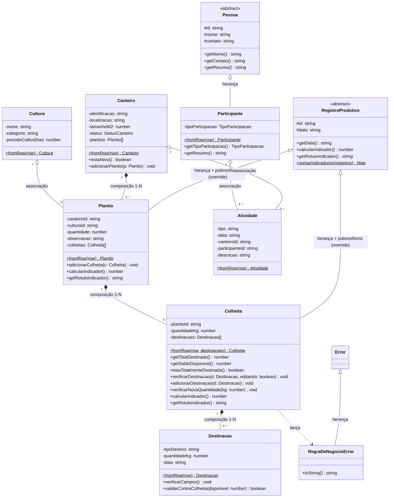

# Diagrama de Classes

Modelo de domínio orientado a objetos do Horta Comunitária, implementado em
[`/src/domain`](../src/domain). As classes envelopam as linhas das tabelas de
[`/database/schema.sql`](../database/schema.sql) (cada uma tem um `fromRow()`
que converte a coluna `snake_case` do banco para o atributo `camelCase` da
classe) e concentram as regras de negócio. Contém os elementos exigidos pela
AEP: **classe abstrata**, **herança**, **polimorfismo via `override`** e
**composição de multiplicidade 1:N**.

Legenda: `*` depois do método = abstrato; `$` = estático; `#` protegido;
`-` privado; `+` público.

## Onde está cada requisito de POO no código

| Pilar | Onde | Como é usado no app |
|---|---|---|
| **Classe abstrata** | [`Pessoa`](../src/domain/Pessoa.ts) e [`RegistroProdutivo`](../src/domain/RegistroProdutivo.ts) (`abstract class`, métodos `abstract`) | Não podem ser instanciadas; obrigam as subclasses a implementar `getResumo()` / `calcularIndicador()` / `getRotuloIndicador()`. |
| **Herança** | `Participante extends Pessoa`; `Plantio` e `Colheita extends RegistroProdutivo`; `RegraDeNegocioError extends Error` | Atributos e métodos comuns (`id`, `data`, `getNome()`…) ficam na superclasse. |
| **Polimorfismo (`override`)** | `calcularIndicador()` e `getRotuloIndicador()` sobrescritos em [`Plantio`](../src/domain/Plantio.ts) (mudas/sementes) e [`Colheita`](../src/domain/Colheita.ts) (kg colhidos); `getResumo()` em `Participante` | O **Painel** ([`src/routes/index.tsx`](../src/routes/index.tsx)) monta um `RegistroProdutivo[]` com plantios e colheitas e chama `RegistroProdutivo.somarIndicadores()`, que invoca o mesmo método sem saber o subtipo. O `tsconfig` usa `noImplicitOverride`, então o compilador exige a palavra `override`. |
| **Composição 1:N** | `Canteiro → Plantio[]`, `Plantio → Colheita[]`, `Colheita → Destinacao[]` | A regra central (não destinar mais do que o colhido) é `Colheita.verificarDestinacao()`, que soma as destinações que a colheita possui. É usada no servidor ([`src/integrations/db/saldo.ts`](../src/integrations/db/saldo.ts)) e no formulário ([`src/components/EntityCrud.tsx`](../src/components/EntityCrud.tsx)). No banco, o ciclo de vida é reforçado por `ON DELETE CASCADE` (ver [`der.md`](./der.md)). |

**Convenções:** código tipado (TypeScript `strict`), classes e tipos em
`PascalCase`, métodos e atributos em `camelCase`.
